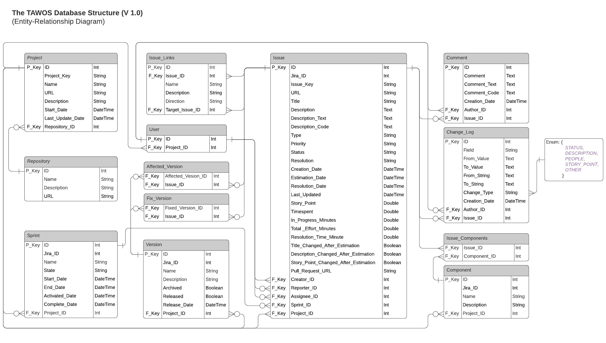

# TAWOS Data Import Manager

A Python web application that imports the TAWOS MySQL dump (`TAWOS.sql`, ~5.6 GB) into an existing
XAMPP MariaDB database **one table at a time**, with real progress tracking, duplicate prevention,
foreign-key awareness, resumable jobs and a persistent job log.

It replaces phpMyAdmin's browser import: the dump is streamed from disk, never loaded into memory,
and never modified.

## What was found in the real dump

Before implementation the dump and the live database were inspected:

| Item | Finding | How it is handled |
|---|---|---|
| Producer | `mysqldump 10.13`, MySQL **8.0.21**, source DB `tawos_cleaned` | Header parsed and shown in the UI |
| Statements | 4,153 extended `INSERT INTO \`Table\` VALUES (...),(...)`, ~1 MB each, no column lists; plus `DROP/CREATE TABLE`, `LOCK/UNLOCK`, `/*!...*/` version comments | Only `INSERT`s for the selected table are executed; everything else is read-only metadata |
| Table names | Dump uses `Affected_Version`, server stores `affected_version` (`lower_case_table_names=1`) | Case-insensitive mapping |
| Column order | Taken from each table's `CREATE TABLE` in the dump | Mapped by name onto the live columns |
| Collation | Dump uses `utf8mb4_0900_ai_ci` (unsupported by MariaDB 10.4) | The dump's DDL is never executed; a compatibility warning is shown |
| Text | Backslash escapes (`\'`, `\\`, `\r\n`), `''`, Unicode | Exact MySQL unescaping, UTF-8 preserved; data values are never rewritten |
| `FOREIGN_KEY_CHECKS=0` in dump | Dump may contain orphan references | FK checks stay **on**; orphan rows are reported individually |
| Keyless tables | `affected_version`, `fix_version`, `issue_component` have no PK/unique key | Duplicates detected by comparing all columns |
| **Schema difference** | Dump's `Project` has an extra column `SP_Field_ID varchar(45)` that the live `project` table lacks | Import of `project` is blocked until you choose: add the column, or ignore it (see below) |

Source row counts (from the index): change_log 9,253,419 · comment 1,518,327 · issue 458,232 ·
issue_component 366,922 · affected_version 264,004 · issue_link 246,587 · fix_version 224,254 ·
user 206,162 · version 6,911 · sprint 4,594 · component 2,001 · project 39 · repository 12.

Import order derived from the live foreign keys:
`repository → project → component, sprint, user, version → issue → change_log, comment, issue_component, issue_link, affected_version, fix_version`.

## Requirements

- Windows/Linux/macOS with Python 3.11+ (developed on 3.14)
- XAMPP MariaDB 10.4+ (or MySQL 5.7+/8.0) with the `tawos` database and its 13 tables already created
- Enough free disk space on the **database** volume (see *Disk space*)

## Step-by-step: running the project

Steps 3–6 are needed only the first time. Commands are for Windows PowerShell.

### Step 1: Get the TAWOS dataset
Download the TAWOS SQL dump (DOI [10.5522/04/21308124](https://doi.org/10.5522/04/21308124)), unzip it,
and note where `TAWOS.sql` is saved. The default path is
`D:\Website\Journal_Research\T2_PM-RAG\TAWOS-dataset\TAWOS.sql\TAWOS.sql`.

### Step 2: Start MySQL
Open the **XAMPP Control Panel** and click **Start** next to **MySQL**. The `tawos` database and its 13
tables must already exist (created from `TAWOS_Database_Schema_Creation_Script.sql`).

### Step 3: Open a terminal in the project folder
```powershell
cd D:\Website\Journal_Research\T2_PM-RAG\data_migration_python
```

### Step 4: Create and activate the virtual environment (first time only)
```powershell
python -m venv .venv
.\.venv\Scripts\Activate.ps1
```
Your prompt now starts with `(.venv)`. If PowerShell says *running scripts is disabled*, run
`Set-ExecutionPolicy -Scope CurrentUser -ExecutionPolicy RemoteSigned` once and activate again.
In Command Prompt (cmd.exe) use `.venv\Scripts\activate.bat`; to leave the environment, run `deactivate`.

### Step 5: Install dependencies (first time only)
```powershell
python -m pip install -r requirements.txt
```

### Step 6: Create the configuration file (first time only)
```powershell
Copy-Item .env.example .env
```
The defaults already use `localhost:3306`, database `tawos`, user `root` with an empty password, and
the default dump path. Edit `.env` only if any of these differ (see *Configuration* below).

### Step 7: Resolve the `project.SP_Field_ID` difference (first time only)
Either add the column or choose to ignore it, as described in
[The `project.SP_Field_ID` decision](#the-projectsp_field_id-decision).

### Step 8: Start the application
```powershell
python run.py
```
Leave this terminal open; closing it stops the server. Without activating the environment you can run
`.\.venv\Scripts\python.exe run.py` instead.

### Step 9: Open the dashboard
Open <http://127.0.0.1:8000> in your browser.
- On first start the dump is indexed once (~75 s for 4.3 GB). A progress bar appears under
  *SQL dump file*; afterwards the index is cached in `state/`.
- Check that the header shows **Connected** and **Valid & readable**.

### Step 10: Import the tables in order
1. Work down the table in the order of the **#** column: `repository`, `project`, `component`,
   `sprint`, `user`, `issue`, `change_log`, `comment`, `issue_component`, `issue_link`, `version`,
   `affected_version`, `fix_version`. A table whose parent tables are still empty is blocked with a
   message naming the table to import first.
2. Click **Data Insert** on a table. The dialog runs the preflight checks first.
3. Keep the defaults (**Skip existing records**, **Continue**, batch size 1000) and click **Start import**.
4. Wait for the status to become **Completed**, then go to the next table.

### Step 11: Check the results
- **Existing Records** should equal **Source Records**. Click **Refresh counts** if needed.
- In the **Import job log**, **Details** lists any failed rows with SQL line numbers.
- If a job is cancelled or interrupted, click **Resume** to continue from its last checkpoint.

### Step 12: Stop the application
Press **Ctrl + C** in the terminal. Job history is kept and appears again on the next start.

### Optional: run the tests
```powershell
python -m pytest
```
The tests use a temporary `tawos_importer_test` database and never touch `tawos`.

## Configuration (`.env`)

All settings are optional; defaults match the XAMPP setup. See `.env.example` for the full list.

| Variable | Default | Purpose |
|---|---|---|
| `TAWOS_SQL_PATH` | `D:\...\TAWOS.sql\TAWOS.sql` | Source dump (opened read-only) |
| `DB_HOST` / `DB_PORT` / `DB_NAME` | `localhost` / `3306` / `tawos` | Target database |
| `DB_USER` / `DB_PASSWORD` | `root` / *(empty)* | Credentials (never shown in UI or logs) |
| `IMPORT_BATCH_SIZE` | `1000` | Rows per transaction |
| `IMPORT_BATCH_MAX_BYTES` | `8388608` | Flush a batch early when its data exceeds this |
| `DEFAULT_DUPLICATE_POLICY` | `skip_existing` | `skip_existing`, `fail_on_duplicate`, `upsert` |
| `DEFAULT_ERROR_POLICY` | `continue` | `continue` or `stop` |
| `MAX_CONCURRENT_JOBS` | `2` | Unrelated tables may run in parallel |
| `IGNORE_SOURCE_COLUMNS` | *(empty)* | e.g. `project.SP_Field_ID` to deliberately skip a source column |
| `SESSION_SQL_MODE` | `STRICT_TRANS_TABLES,NO_AUTO_VALUE_ON_ZERO,NO_ENGINE_SUBSTITUTION` | Strict: bad values are rejected and reported, not silently truncated |
| `DISK_SPACE_FACTOR` / `DISK_SPACE_RESERVE_GB` | `3.0` / `2` | Disk check: remaining source bytes × factor + reserve |

### The `project.SP_Field_ID` decision

The live `project` table has no `SP_Field_ID` column, so importing `project` as-is would silently drop
that data. The importer refuses until you pick one:

1. **Keep the data** (recommended) — add the column, then import:
   ```sql
   ALTER TABLE `project` ADD COLUMN `SP_Field_ID` varchar(45) DEFAULT NULL AFTER `Last_Update_Date`;
   ```
2. **Drop the data deliberately** — add `IGNORE_SOURCE_COLUMNS=project.SP_Field_ID` to `.env` and restart.

All other tables match the live schema exactly. (In this environment option 1 was chosen and the
column has already been added to `tawos.project`.)

## Using the dashboard

- The header shows the database connection, server version, the SQL file path, size and validation
  status, and the indexing progress.
- The table list shows, for each of the 13 tables: import order, existing records (exact
  `COUNT(*)`), source records, status, a live progress bar (records processed of total, inserted,
  skipped, failed, elapsed time, stage) and a **Data Insert** button.
- **Data Insert** opens a dialog that first runs the preflight checks (file, connection, column
  mapping, prerequisite tables, disk space, compatibility) and lets you choose the duplicate policy,
  error policy and batch size.
- While a table is importing its button is disabled and a **Cancel** button appears. Tables linked
  to it by a foreign key are also disabled until it finishes; unrelated tables can run in parallel.
- The **Import job log** lists every job with timestamps, counts, the last checkpoint and buttons
  for **Details** (row-level errors with SQL line numbers), **Cancel** and **Resume**.

Recommended sequence: follow the numbers in the `#` column (repository, project, component, sprint,
user, version, issue, then the issue-dependent tables).

## How it works

```
app/
  config.py         settings from .env, table allowlist
  sql_parser.py     streaming statement splitter + INSERT row parser (bytes in, Python values out)
  source_index.py   one-pass dump index: per-table byte range, row count, CREATE TABLE columns
  db.py             SQLAlchemy/PyMySQL access, schema + FK inspection, topological import order
  importer.py       preflight checks and the table import service
  job_manager.py    background threads, concurrency rules, cancel/resume
  job_store.py      SQLite persistence (jobs, row errors, index cache) in state/
  main.py           FastAPI routes; templates/ + static/ for the dashboard
```

**Parsing.** Statements are found with a single possessive regular expression that consumes string
literals, quoted identifiers and comments atomically, so `;`, `,`, `),(`, `--` or newlines inside
values never split a statement. A bounded buffer is used; a construct cut at the buffer edge cannot
match a terminator, so the reader just reads more. Row values are tokenised with MySQL escape rules
(`\0 \' \" \b \n \r \t \Z \\`, `''`, `\%`/`\_` preserved), `NULL`, integers, decimals (kept exact
as `Decimal`), hex/`_binary`/bit literals. Invalid UTF-8 is detected per value and the row is
rejected rather than mangled. `INSERT ... SELECT/SET` and `ON DUPLICATE KEY UPDATE` are reported as
unsupported with line numbers.

**Table-specific import.** The index records where each table's `INSERT`s are, so a job seeks
directly to that byte range and only parses statements for the selected table.

**Per batch** (default 1000 rows, one transaction):
1. duplicate keys inside the batch are collapsed;
2. keys already present in the table are looked up (`PRIMARY KEY`, else unique key, else all columns
   with null-safe comparison) and handled by the policy;
3. every single-column foreign key value is checked against its parent table; rows with a missing
   parent are reported (`Creator_ID=999 has no matching record in user.ID`) instead of failing the
   batch;
4. the remaining rows are bulk-inserted with parameterised `executemany`; if the server still
   rejects something, the batch is retried row by row within a savepoint so only the bad rows fail;
5. the transaction commits and the checkpoint (byte offset, line, row within statement, table row
   number) is saved.

**Duplicate policies.**
- `skip_existing` (default): new rows are inserted, existing ones counted as *skipped*. Re-running an
  import is always safe and inserts nothing twice.
- `fail_on_duplicate`: existing rows are reported as failures (useful for auditing).
- `upsert`: existing rows are refreshed by primary key (`ON DUPLICATE KEY UPDATE`); nothing is ever
  deleted, keys never change, so foreign keys stay valid. Not available for keyless tables.

No policy truncates tables, drops anything, or disables `FOREIGN_KEY_CHECKS`/`UNIQUE_CHECKS`.

**Error policies.** `continue` commits valid rows and logs failed ones. `stop` rolls back the batch
containing the first failure and stops, so a later resume retries exactly that batch.

**Resume and retry.** *Resume* starts a new job from the last committed checkpoint of a failed,
cancelled or interrupted job. A fresh *Data Insert* re-reads the whole table; with `skip_existing`
it only inserts what is missing, which is the way to retry rows that failed earlier (for example
after importing a missing parent table).

**Cancellation.** Cancel stops before the next batch; the in-flight batch commits, uncommitted
accumulated rows are discarded, and the checkpoint stays at the last commit.

**Restart recovery.** Jobs live in `state/import_state.sqlite3`. On startup, jobs that were running
when the process stopped are marked *interrupted* and can be resumed.

**Progress** is computed from real counters: table rows consumed ÷ source row count from the index
(or the byte position within the table's range while the index lacks a count). Nothing is
simulated.

## Disk space

The data directory (`C:\xampp\mysql\data`) must hold the table data **plus** secondary indexes, undo
and redo logs and temporary space. The preflight check requires
`remaining source bytes × DISK_SPACE_FACTOR + DISK_SPACE_RESERVE_GB` free on that volume (≈ 8 GB
for `change_log`, ≈ 15 GB for the whole dump with defaults) and blocks the job otherwise.

## Tests

```powershell
.\.venv\Scripts\python.exe -m pytest
```

- `tests/test_parser.py`: splitting across tiny buffers, escapes, Unicode, invalid UTF-8, column
  lists, `INSERT IGNORE`, large multi-chunk statements, LF vs CRLF, error locations.
- `tests/test_index.py`: per-table counts/columns on the fixture, cache reuse, file unchanged.
- `tests/test_integration.py`: real imports into a disposable `tawos_importer_test` database
  (created and dropped by the tests; `tawos` is never touched). Covers FK-derived order,
  prerequisite blocking, single-table isolation, text fidelity, orphan rows, repeat imports,
  every duplicate policy, cancel + resume, stop-policy rollback, the schema-mismatch decision,
  restart recovery.
- `tests/test_api.py`: dashboard, status, validation of table names/policies, import via HTTP.

The fixture `tests/fixtures/sample_dump.sql` mirrors the real dump format (MySQL 8 header,
`utf8mb4_0900_ai_ci`, alphabetical table order, extended inserts, the extra `SP_Field_ID` column)
and adds edge cases. Integration tests are skipped automatically when no server is reachable;
override the server with `TEST_DB_HOST`, `TEST_DB_PORT`, `TEST_DB_USER`, `TEST_DB_PASSWORD`.

## Troubleshooting

| Symptom | Cause / fix |
|---|---|
| *Database: Not connected* | Start MySQL in the XAMPP control panel; check `DB_*` in `.env`. |
| *Import `X` first* | Prerequisite parent table is empty. Import tables in the order shown. |
| *Source column(s) not present* | Schema mismatch (e.g. `project.SP_Field_ID`); see the decision above. |
| Rows fail with `missing_parent` | The dump references parent rows that don't exist (it was exported with FK checks off), or the parent table is incomplete. Import or complete the parent, then run *Data Insert* again with `skip_existing`. |
| *Insufficient disk space* | Free space on the data directory volume or lower `DISK_SPACE_FACTOR` if you are certain. |
| `packet_too_large` | Raise `max_allowed_packet` in `C:\xampp\mysql\bin\my.ini` (`[mysqld]` section) and restart MySQL. Currently 512 MB. |
| Slow imports on large tables | Increase `IMPORT_BATCH_SIZE` (e.g. 5000); for MariaDB consider `innodb_buffer_pool_size` ≥ 1G and `innodb_log_file_size` ≥ 256M in `my.ini` (XAMPP defaults are 16M/5M). |
| Index stuck in *error* | Check `logs/app.log`; *Rebuild index* after fixing the file path. |
| Job *interrupted* | The server stopped mid-job. Click *Resume*. |

Logs: `logs/app.log` (rotating, 10 MB × 5) and `logs/jobs/<job_id>_failures.jsonl` (every failed
row with key, SQL line and reason).

## Screenshots

### TAWOS Data Import Manager dashboard


### TAWOS database entity-relationship diagram



*Entity-relationship diagram from the [TAWOS dataset repository](https://github.com/SOLAR-group/TAWOS).*

## Credits

The data imported by this tool is the **TAWOS dataset** (Tawosi Agile Web-hosted Open-Source Issues),
created and published by the SOLAR group at University College London:

- Website: <https://github.com/SOLAR-group/TAWOS>
- Dataset download: DOI [10.5522/04/21308124](https://doi.org/10.5522/04/21308124)
- Licence: Apache License, Version 2.0. Please read the dataset's terms of use before using it; the
  data is intended for research purposes.

If you use the dataset in your research, please cite the original paper:

> Vali Tawosi, Afnan Al-Subaihin, Rebecca Moussa and Federica Sarro. "A Versatile Dataset of Agile
> Open Source Software Projects." *Proceedings of the 19th International Conference on Mining
> Software Repositories (MSR 2022)*, pp. 707–711. doi:10.1145/3524842.3528029

```bibtex
@INPROCEEDINGS{9796320,
  author={Tawosi, Vali and Al-Subaihin, Afnan and Moussa, Rebecca and Sarro, Federica},
  booktitle={2022 IEEE/ACM 19th International Conference on Mining Software Repositories (MSR)},
  title={A Versatile Dataset of Agile Open Source Software Projects},
  year={2022},
  pages={707-711},
  doi={10.1145/3524842.3528029}}
```
